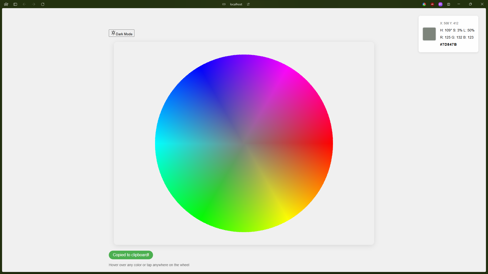
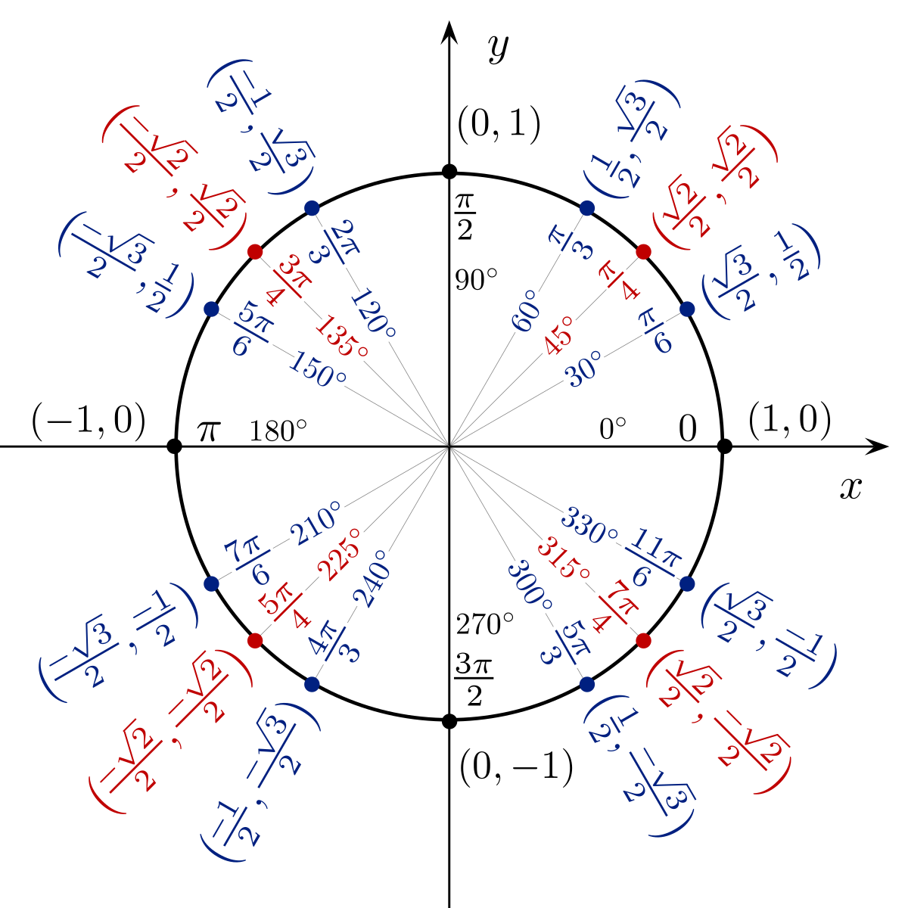

# Color Wheel

<p align="center">
  <a href="https://github.com/Prarambha369/ColorWheel">
    
  </a>
  <a href="https://react.dev/">
    
  </a>
  <a href="https://vitejs.dev/">
    
  </a>
  <a href="https://developer.mozilla.org/en-US/docs/Web/JavaScript">
    
  </a>
  <a href="https://github.com/sponsors/Prarambha369">
    
  </a>
</p>
<p align="center">
  <strong>An interactive color wheel application built with React and Vite. Explore, select, and copy colors with mathematical precision.</strong>
</p>

---
## Demo

<p align="center">
  
</p>

## Features
- **Interactive Color Wheel**: Hover or click anywhere on the canvas to select a color.
- **Real-time Color Details**: Instantly displays HSL, RGB, and Hex values of the selected color.
- **Detailed Modal Popup**: View expanded color information and preview in a clean modal.
- **Responsive Design**: Fully optimized for desktop, tablet, and mobile screens.
## Technical Explanation
### 36,000 Dots
The color wheel is drawn with 36,000 uniquely colored dots arranged in a circular pattern. Each 1° segment represents a single hue, and the saturation increases with the distance from the center. Since there are 360 degrees in a circle (360 hues) and saturation is expressed in 100 percentage points, we get `360 × 100 = 36,000` dots when working with integers.
### The Color Wheel Mathematics
To draw these 36,000 dots in a circular pattern, we use the sine function to determine the Y coordinate and the cosine function to determine the X coordinate. JavaScript's `Math.sin` and `Math.cos` expect angles in radians, so we convert degrees to radians first (`radians = degrees × π / 180`). A full circle equals 360 degrees or 2π radians.

<p align="center">
  
</p>

<p align="center">
  
   
  <br><em>Image from wikimedia.org</em>
</p>

We use the saturation as the radius of our circle for each iteration (0 - 100).
The color wheel consists of 100 circles with varying radius based on the saturation. If we draw every 5th saturation circle, the wheel would look like this:

<p align="center">
  
</p>

Another way we can define the color wheel is by 360 1° segments with a different color. The angle (0 - 360) defines the hue (0 - 360) of the color. If we draw every 5th hue segment, the wheel would look like this:

<p align="center">
  
</p>

The first color in the hue scale (value 0) is red and lies directly to the right of the center of the wheel. This makes sense since we generally measure angles relative to the positive x-axis.

<p align="center">
  
   
  <br><em>Image from wikimedia.org</em>
</p>
### The Color Picker
When you hover over (or tap) a color in the color wheel, its information is displayed in the top left corner of the canvas. To achieve this, we need to determine the color based on the relative x and y values of the cursor.
#### Saturation
Determining the saturation of the color based on the x and y values is quite straightforward. We just need to calculate the distance of that point to the center of the wheel, which is conveniently positioned at the center of the canvas. To calculate the distance between 2 points on a 2D plane, we use the Pythagorean theorem: a² + b² = c², where:
- `a` is the absolute difference in x values of the point and the center
- `b` is the absolute difference in y values
- `c` is the resulting distance from the center of the wheel

<p align="center">
  
  <br><em>Image from mathsisfun.com</em>
</p>

#### Hue
To determine the hue of the color based on the x value of the cursor, we need to inverse the cosine function we used to calculate the position of the dot in the color wheel. If we want to base ourselves on the y value, we have to inverse the sine function. In this case, we use the x value, and we quickly notice that there are always 2 colors for every given x value and distance from the center of the wheel. To get around this issue, we add a check to determine whether the cursor is above or below the vertical middle (y) of the wheel, and we inverse the hue value of the color when the cursor is below.

<p align="center">
  
</p>

If we base ourselves on the y value to determine the hue, we will find 2 colors for every given y value and distance from the center, and we need to adapt the hue value based on the position of the cursor to the left or right of the horizontal middle (x) of the wheel.
### Color Notations
For converting the colors in HSL (hue, saturation, lightness) notation to RGB (red, green, blue), we use the formula as explained at [RapidTables](https://www.rapidtables.com/convert/color/hsl-to-rgb.html). To convert the RGB value to hexadecimal notation, we just need to convert the base 10 integers (0 - 255) representing the red, green, and blue values to their hexadecimal equivalent.

## Technologies Used
- [React](https://react.dev/) - UI component library
- [Vite](https://vitejs.dev/) - Fast frontend build tool & dev server
- [JavaScript](https://developer.mozilla.org/en-US/docs/Web/JavaScript) - Core application logic
- [CSS3](https://developer.mozilla.org/en-US/docs/Web/CSS) - Styling & responsiveness
## Getting Started
### Prerequisites
- Node.js (version 14 or higher)
- npm (version 6 or higher)
### Installation
1. Clone the repository:
   ```bash
   git clone https://github.com/Prarambha369/ColorWheel.git
   ```
2. Navigate to the project directory:
   ```bash
   cd ColorWheel
   ```
3. Install dependencies:
   ```bash
   npm install
   ```
4. Start the development server:
   ```bash
   npm run dev
   ```
5. Open the application in your browser:
   ```
   http://localhost:5173 (or the port displayed in your terminal)
   ```
## Acknowledgements
- [React](https://react.dev/)
- [Vite](https://vitejs.dev/)
- [React Modal](https://reactcommunity.org/react-modal/)
- [Original Inspiration](https://github.com/jbrems/color-wheel)

<div align="center">

## Support the Project
If you found this project helpful or enjoy exploring color theory through code, consider sponsoring the development!

<p align="center">
  <a href="https://github.com/sponsors/Prarambha369">
    
  </a>
</p>

Your support helps maintain open-source projects and fund future improvements. Thank you! 🌟

</div>
